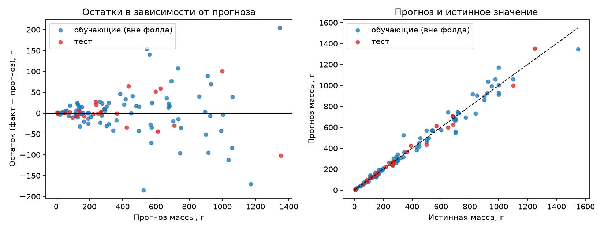

# Лабораторная работа №2. FishGrow: прогностическая модель массы рыбы и MLflow

Автор: `Осипов Владислав Алексеевич` · Ветка: `lab/02-regression`

## 1. Постановка

Требуется предсказывать массу рыбы по геометрическим измерениям и виду.

- **Целевая переменная:** `Weight`, масса в граммах.
- **Входные признаки:** `Length1`, `Length2`, `Length3`, `Height`, `Width` (измерения в сантиметрах) и категориальный `Species`.
- **Метрики:** MSE, MAE (в граммах) и R². Отрицательный R² означает результат хуже прогноза константой-средним.
- **Критерии успеха:** (1) модель заметно лучше наивного прогноза E0; (2) сравнение моделей честное: один набор данных, одно разбиение, предобработка внутри цепочки; (3) результат воспроизводится по README; (4) нет утечки из тестовой выборки.

## 2. Данные, разбиение и проверки

**Данные.** Файл `data/fish_participant.csv`: 111 строк, 7 видов, пропусков и полных дубликатов нет, `Weight > 0` во всех строках. Контрольная сумма SHA-256 записана в `configs/split_indices.json`.

**Важная находка про `fish_holdout_demo.csv`.** Все 28 строк этого файла целиком входят в `fish_participant.csv`. Оценка на нём равна оценке на обучающих данных, поэтому он **не использовался** как тест, а числа исходного проекта (R² ≈ 0.975 на demo) не сравниваются с нашими. Настоящего скрытого набора в репозитории нет, поэтому тест выделен из имеющихся 111 строк.

**Разбиение.** 80/20 со стратификацией по `Species`, `random_state = 42` (`src/split.py`). Индексы сохранены в `configs/split_indices.json`, все скрипты читают их оттуда и не делят данные заново.

| Вид       | Обучение | Тест   |
| --------- | -------- | ------ |
| Bream     | 19       | 5      |
| Parkki    | 6        | 2      |
| Perch     | 31       | 8      |
| Pike      | 10       | 2      |
| Roach     | 11       | 3      |
| Smelt     | 8        | 2      |
| Whitefish | 3        | 1      |
| **Всего** | **88**   | **23** |

Групп (ферма, партия) в данных нет, поэтому `GroupKFold` не применялся. Но неизвестно, не относятся ли несколько рыб к одной партии. Это ограничение (раздел 7).

**Кросс-валидация.** Только на 88 обучающих строках: `RepeatedKFold`, 5 частей × 3 повтора. Для моделей с гиперпараметрами использована вложенная проверка: внутри каждой внешней обучающей части параметры подбираются своим `KFold(5)`, поэтому оценки не завышены подбором. Тест открывался один раз (`src/final.py`), после того как лучшая модель была выбрана по кросс-валидации.

**Предобработка внутри цепочки.** Заполнение пропусков, логарифм признаков, масштабирование и кодирование вида настраиваются только на обучающих данных каждой итерации (`sklearn.Pipeline`, `ColumnTransformer`). Неизвестный вид обрабатывается как нулевой вектор (`handle_unknown="ignore"`).

**Выбросы.** Строка 13 (Pike, 1550 г, самая тяжёлая рыба) **оставлена**: это крупнейшее наблюдение, полезное для проверки обобщения (решение согласовано с лабораторной №1). Автор исходного проекта удалял её жёстко по номеру до разбиения.

### Паспорт данных

Таблица построена скриптом `src/passport.py` по всему файлу (111 строк); она описывает данные и в обучении не участвует. Полная версия: `reports/tables/data_passport.md`.

| Поле    | Смысл                                      | Тип                   | Единицы           | Роль                                                        | Пропуски | Диапазон / словарь                                                                   | Проверки                                                                       |
| ------- | ------------------------------------------ | --------------------- | ----------------- | ----------------------------------------------------------- | -------- | ------------------------------------------------------------------------------------ | ------------------------------------------------------------------------------ |
| Species | вид рыбы                                   | категориальный        | словарь категорий | признак; ключ стратификации разбиения (группой не является) | 0 из 111 | Perch (39), Bream (24), Roach (14), Pike (12), Smelt (10), Parkki (8), Whitefish (4) | 7 видов; пустых строк: 0; дубликатов написания: 0; самый редкий: Whitefish (4) |
| Weight  | масса рыбы                                 | числовой              | граммы            | целевая переменная                                          | 0 из 111 | 5.90 – 1550.00                                                                       | значений ≤ 0: 0                                                                |
| Length1 | первая длина                               | числовой              | см                | признак (сильно коррелирует с Length2, Length3)             | 0 из 111 | 7.50 – 56.00                                                                         | значений ≤ 0: 0                                                                |
| Length2 | вторая длина                               | числовой              | см                | признак (сильно коррелирует с Length1, Length3)             | 0 из 111 | 8.40 – 60.00                                                                         | значений ≤ 0: 0; Length1 > Length2: 0                                          |
| Length3 | третья длина (предположительно наибольшая) | числовой              | см                | признак                                                     | 0 из 111 | 8.80 – 64.00                                                                         | значений ≤ 0: 0; Length2 > Length3: 0                                          |
| Height  | высота тела                                | числовой              | см                | признак                                                     | 0 из 111 | 1.74 – 18.96                                                                         | значений ≤ 0: 0                                                                |
| Width   | ширина тела                                | числовой              | см                | признак                                                     | 0 из 111 | 1.05 – 8.14                                                                          | значений ≤ 0: 0                                                                |
| V_proxy | приближённый объём = Length3·Height·Width  | числовой, производный | см³ (условно)     | признак эксперимента E4; цель не используется               | 0 из 111 | 19.67 – 5771.40                                                                      | значений ≤ 0: 0                                                                |

Что подтверждено данными, а что предположение:

- **Факты (проверено кодом):** пропусков нет; значений ≤ 0 нет; во всех строках `Length1 ≤ Length2 ≤ Length3`; пустых строк и дубликатов написания видов нет; полных дубликатов строк нет.
- **Предположения:** единицы (см для размеров, г для массы) приняты по описанию набора, в самом файле они не записаны; смысл `Length1–3` (какая именно длина измерена) в данных не документирован, трактовка `Length3` как наибольшей длины основана только на её значениях (во всех строках она наибольшая).
- **Единица наблюдения:** одна строка — одна рыба. Столбцов фермы, партии или времени измерения нет, поэтому неизвестно, не относятся ли несколько рыб к одной партии (см. ограничения).
- **Утечки:** идентификаторов в таблице нет; признаки не вычисляются из массы. Производный `V_proxy` считается только из измерений.

## 3. Базовое решение и изменения относительно исходного проекта

Исходная модель: линейная регрессия, логарифм признаков `Length3`, `Height`, `Width` и логарифм массы, one-hot по `Species`. В нашей работе она воспроизведена как **E1c** внутри единой цепочки.

Изменения:

- честное разбиение вместо оценки на `fish_holdout_demo.csv`;
- метрики MSE, MAE, R² и их разброс по перекрёстной проверке;
- удалено ручное исключение строки по номеру, зафиксирован `random_state`;
- подбор гиперпараметров по кросс-валидации, регуляризованные и нелинейные модели, эксперимент с признаком объёма;
- журнал экспериментов в MLflow, автоматические тесты, сохранённая модель и паспорт модели.

## 4. Таблица экспериментов

Кросс-валидация: среднее по фолдам (в скобках стандартное отклонение MSE). Тест: 23 строки.

| №         | Модель                                            | Выбранные параметры | CV MSE (±std)      | CV MAE, г | CV R²     | Тест MSE  | Тест MAE, г | Тест R²   |
| --------- | ------------------------------------------------- | ------------------- | ------------------ | --------- | --------- | --------- | ----------- | --------- |
| E0-mean   | среднее обучающей выборки                         | —                   | 119 095 (±22 939)  | 294.3     | −0.112    | 106 323   | 268.5       | −0.021    |
| E0-median | медиана обучающей выборки                         | —                   | 130 713 (±35 046)  | 284.1     | −0.208    | 108 359   | 238.2       | −0.040    |
| E1a       | линейная, все длины, масса без лога               | —                   | 15 052 (±9 815)    | 79.9      | 0.867     | 7 532     | 74.0        | 0.928     |
| E1b       | линейная, все длины, цель log(1+y)                | —                   | 28 928 (±35 347)   | 75.5      | 0.764     | 24 168    | 68.4        | 0.768     |
| **E1c**   | **базовое решение автора** (лог признаков и цели) | —                   | **3 330 (±1 982)** | **32.5**  | **0.970** | **1 574** | **25.0**    | **0.985** |
| E2a       | Ridge, признаки автора, лог                       | alpha = 0.01        | 3 444 (±2 250)     | 32.6      | 0.970     | 1 584     | 25.1        | 0.985     |
| E2b       | Ridge, все три длины, лог                         | alpha = 1.0         | 3 650 (±2 118)     | 33.8      | 0.968     | 1 621     | 25.8        | 0.984     |
| E3a       | случайный лес, цель без лога                      | глубина 4, лист 4   | 8 940 (±10 987)    | 47.2      | 0.929     | 6 840     | 50.5        | 0.934     |
| E3b       | случайный лес, цель log(y)                        | глубина 4, лист 4   | 8 552 (±10 092)    | 45.6      | 0.932     | 7 892     | 51.6        | 0.924     |
| E4a       | Ridge без логарифмов, без V                       | alpha = 1.0         | 14 124 (±9 263)    | 77.6      | 0.876     | 8 053     | 73.8        | 0.923     |
| E4b       | то же, с V = Length3·Height·Width                 | alpha = 0.001       | 6 759 (±5 065)     | 49.3      | 0.941     | 2 751     | 38.6        | 0.974     |
| E4c       | Ridge в логарифмах с V                            | alpha = 0.01        | 3 460 (±2 271)     | 32.7      | 0.969     | 1 585     | 25.1        | 0.985     |

Параметры во второй колонке получены на всей обучающей части. Сетки заданы заранее: `alpha ∈ {0.001, 0.01, 0.1, 1, 10, 100}`; для леса 100 деревьев, `max_depth ∈ {4, 8, None}`, `min_samples_leaf ∈ {1, 2, 4}`. Вычислительный бюджет: около 4–10 с на эксперимент с Ridge и около 21 с на эксперимент с лесом (метрика `duration_sec` в MLflow).

### Комментарии к экспериментам

- **E0.** Наивный прогноз даёт R² около нуля или ниже: это нижняя планка, от которой отсчитывается польза моделей.
- **E1.** График остатков (раздел 6) показывает «воронку»: абсолютные ошибки растут с массой, то есть дисперсия остатков неоднородна. Это визуальный вывод, формальный тест (например, Бройша–Пагана) не проводился. Три длины почти дублируют друг друга: корреляции на обучающих данных `Length1`–`Length2` = 0.999, `Length1`–`Length3` = 0.991, `Length2`–`Length3` = 0.994. В логарифмах признаков, выбранных автором, корреляции ниже (0.84–0.93). Вариант с логарифмом только цели при сырых признаках (E1b) оказался хуже и нестабильным (std MSE больше среднего). Вероятная причина: масса растёт примерно как куб длины, поэтому линейная связь в логарифмах возникает только если логарифмировать и признаки (это гипотеза, отдельно она не проверялась).
- **E2.** Ridge не улучшил E1c: разница меньше разброса по фолдам. Ridge на всех трёх длинах (E2b) не хуже, несмотря на сильную коррелированность, и выбрал более сильную регуляризацию (alpha = 1.0 против 0.01). Коэффициенты Ridge сравнимы между числовыми признаками только после согласованного масштабирования (в цепочке стоит `StandardScaler`).
- **E3.** Лес хуже линейных моделей. Вероятная причина: лес не выходит за пределы масс, которые видел, а зависимость степенная. Лучшие параметры оказались на границе сетки (минимальная глубина, максимальный лист), поэтому возможно, что оптимум лежит за её пределами; сетка после просмотра результатов не менялась.
- **E4.** Сравнение одной и той же модели (Ridge без логарифмов) без V и с V = `Length3 · Height · Width` на одних и тех же данных и разбиении. Признак вычисляется только из измерений рыбы, массу не использует. С V: MSE 14 124 → 6 759, MAE 77.6 → 49.3 г, R² 0.876 → 0.941. Улучшение есть по всем метрикам, но разброс по фолдам большой, поэтому его следует считать заметным, но не строго доказанным. В логарифмической модели V ничего не добавляет (E4c = E2a, 3 460 против 3 444): log V = log L + log H + log W, то есть V есть точная комбинация уже имеющихся признаков.

### Мультиколлинеарность (E1, E2, E4)

Расчёты: `src/collinearity.py`, только по обучающим данным (88 строк); таблицы в `reports/tables/` (`correlations_raw.csv`, `correlations_log.csv`, `vif.csv`, `coef_stability.csv`).

**Корреляции.** Три длины почти совпадают: `Length1`–`Length2` 0.999, `Length1`–`Length3` 0.991, `Length2`–`Length3` 0.994. Производный `V_proxy` коррелирует с `Height` 0.890, `Width` 0.881, `Length3` 0.818 (в логарифмах: 0.959, 0.976, 0.950).

**VIF** (VIF > 10 считают признаком серьёзной мультиколлинеарности):

| Набор признаков                                | Шкала    | VIF                             |
| ---------------------------------------------- | -------- | ------------------------------- |
| Length3, Height, Width (E1c, E4a)              | исходная | 4.0 / 2.6 / 5.2                 |
| то же                                          | логарифм | 6.9 / 5.2 / 10.3                |
| Length3, Height, Width, V (E4b)                | исходная | 4.2 / 4.9 / 6.2 / V: 9.0        |
| то же (E4c)                                    | логарифм | бесконечность у всех четырёх    |
| Length1, Length2, Length3, Height, Width (E2b) | исходная | 1557 / 2092 / 418 / 14 / 12     |
| то же                                          | логарифм | 1229 / 1756 / 425 / 18.5 / 24.3 |

В логарифмах VIF у набора с `V` бесконечен, потому что log V = log L + log H + log W: признак точно выражается через остальные.

**Устойчивость коэффициентов** (бутстреп, 200 выборок обучающих строк; коэффициенты при стандартизованных признаках; Ridge с фиксированным alpha = 1.0 для наглядного сравнения, а не подобранным):

| Сценарий                               | Признак | МНК: среднее ± std | доля смены знака | Ridge: среднее ± std | доля смены знака |
| -------------------------------------- | ------- | ------------------ | ---------------- | -------------------- | ---------------- |
| E2b, все длины, логарифмы              | Length1 | 0.447 ± 0.496      | 16.0%            | 0.221 ± 0.029        | 0%               |
|                                        | Length2 | −0.541 ± 0.563     | 15.5%            | 0.219 ± 0.025        | 0%               |
|                                        | Length3 | 0.740 ± 0.376      | 2.5%             | 0.244 ± 0.031        | 0%               |
| E1c, Length3, Height, Width, логарифмы | Length3 | 0.679 ± 0.130      | 0%               | 0.594 ± 0.062        | 0%               |
|                                        | Height  | 0.375 ± 0.144      | 0%               | 0.353 ± 0.042        | 0%               |
|                                        | Width   | 0.315 ± 0.081      | 0%               | 0.412 ± 0.044        | 0%               |
| E4b, с V, исходная шкала               | Height  | −231.2 ± 95.6      | 0.5%             | −75.8 ± 31.8         | 0.5%             |
|                                        | Width   | −9.2 ± 54.4        | 45.0%            | 18.0 ± 38.1          | 36.5%            |
|                                        | V_proxy | 290.5 ± 43.8       | 0%               | 238.0 ± 28.4         | 0%               |

**Выводы.**

1. При трёх длинах МНК даёт нестабильные коэффициенты: у `Length2` среднее отрицательное (−0.54), хотя длина должна увеличивать массу, а знак меняется почти в каждой шестой выборке. Ridge сжимает разброс примерно в 15–20 раз. Это и есть эффект мультиколлинеарности.
2. Но качество предсказаний при этом почти не меняется (E1c: CV MSE 3 330, E2b: 3 650), поэтому по правилу задания (оценивать по качеству на проверочных данных, а не по коэффициентам) обе модели приемлемы. Выбор E1c соответствует второму варианту из задания: сильно связанные длины заменены одним измерением (`Length3`).
3. `V_proxy` в исходной шкале (VIF 9.0) помогает качеству (E4a → E4b), хотя коэффициент при `Height` меняет знак на отрицательный (−231): интерпретировать отдельные коэффициенты нельзя. Для E4b кросс-валидация выбрала alpha = 0.001, то есть почти МНК: для качества регуляризация не понадобилась, она нужна только для устойчивости коэффициентов.
4. В логарифмах `V_proxy` совершенно избыточен (VIF бесконечен, E4c = E2a); МНК в этом случае даёт какое-то из бесконечного числа решений, а Ridge выбирает единственное устойчивое.
5. Ограничения: оценка устойчивости получена на 88 строках; alpha = 1.0 выбрано для сравнения, а не подбором.

### Журнал экспериментов (MLflow)

Эксперимент MLflow `fish-weight`, локальное хранилище `mlflow.db` + `mlruns/` (в Git не входят; вместо них в репозитории лежит экспорт). Запуски двух видов:

- **Запуски кросс-валидации** (`src/train.py`): параметры (признаки, класс модели, преобразование цели, диапазон гиперпараметров и выбранные значения, seed, схема кросс-валидации, хэш данных), метрики `cv_*` (среднее и std), `duration_sec`, теги (коммит, чистота рабочей копии, версии Python, sklearn, pandas), артефакт: прогнозы вне фолда.
- **Запуски `*-TEST`** (`src/final.py`, по одному на эксперимент): те же параметры плюс описание разбиения, метрики `test_mse`, `test_mae`, `test_r2` вместе с `cv_*`, число неположительных прогнозов, артефакты в папке `test/`: таблица прогнозов и остатков, график остатков и прогноза против истины. У выбранной модели дополнительно: `model.joblib`, формат модели MLflow, `model_meta.json`, и графики и таблицы анализа ошибок (`src/analyze.py`).

Экспорт (`python -m src.export_mlflow`): `reports/tables/mlflow_runs.csv` (все запуски) и `reports/tables/mlflow_structure.txt` (снимок структуры артефактов). Скриншоты интерфейса: `reports/figures/mlflow_ui_runs.png` (список запусков) и `reports/figures/mlflow_ui_compare.png` (сравнение).

## 5. Выбор модели и результат на тесте

Выбрана **E1c**: самый низкий средний MSE на кросс-валидации и самая простая модель из практически равных (E2a отличается в пределах шума). Выбор сделан до просмотра теста. Результат на тесте (23 строки): **MSE = 1 574, MAE = 25.0 г, R² = 0.985**. Порядок моделей на тесте совпал с порядком по кросс-валидации. Тест малый, поэтому его оценка шумна, и более низкая ошибка, чем в кросс-валидации, не доказывает лучшего обобщения.

## 6. Анализ ошибок (модель E1c)



На графике слева видна «воронка»: разброс остатков растёт с массой. На графике справа точки лежат вдоль диагонали; самая тяжёлая рыба (1550 г) недооценена.

**Пять крупнейших ошибок** (прогнозы вне фолда на обучающих данных; номер — позиция строки в `data/fish_participant.csv`, отсчёт с нуля):

| Строка | Вид   | Length1 | Length2 | Length3 | Height | Width | Факт, г | Прогноз, г | Остаток, г |
| ------ | ----- | ------- | ------- | ------- | ------ | ----- | ------- | ---------- | ---------- |
| 13     | Pike  | 56.0    | 60.0    | 64.0    | 9.6    | 6.1   | 1550    | 1345.5     | +204.5     |
| 68     | Bream | 29.5    | 32.0    | 37.3    | 13.9   | 5.1   | 340     | 524.8      | −184.8     |
| 41     | Perch | 40.2    | 43.5    | 46.0    | 12.6   | 8.1   | 1000    | 1170.0     | −170.0     |
| 4      | Bream | 30.4    | 33.0    | 38.3    | 14.9   | 5.3   | 700     | 546.0      | +154.0     |
| 6      | Bream | 30.4    | 33.0    | 38.5    | 14.9   | 5.2   | 700     | 559.7      | +140.3     |

Крупнейшие ошибки на тесте: `reports/tables/top_errors_test.csv`.

**MAE по видам** (в % от массы: средняя относительная ошибка):

| Вид       | Обучение вне фолда: n | MAE, г | %    | Тест: n | MAE, г | %    |
| --------- | --------------------- | ------ | ---- | ------- | ------ | ---- |
| Bream     | 19                    | 56.4   | 10.3 | 5       | 41.2   | 6.8  |
| Parkki    | 6                     | 9.7    | 6.8  | 2       | 1.9    | 1.1  |
| Perch     | 31                    | 27.9   | 7.2  | 8       | 20.7   | 5.0  |
| Pike      | 10                    | 55.4   | 8.3  | 2       | 73.1   | 8.0  |
| Roach     | 11                    | 14.4   | 8.6  | 3       | 17.4   | 8.5  |
| Smelt     | 8                     | 1.0    | 6.7  | 2       | 0.9    | 11.6 |
| Whitefish | 3                     | 42.9   | 5.7  | 1       | 0.3    | 0.1  |

**MAE по размеру** (группы по терцилям массы обучающих данных):

| Группа  | Обучение: n | MAE, г | Смещение, г | Тест: n | MAE, г | Смещение, г |
| ------- | ----------- | ------ | ----------- | ------- | ------ | ----------- |
| малые   | 30          | 7.3    | +1.1        | 7       | 3.8    | −1.0        |
| средние | 29          | 27.4   | −6.4        | 10      | 16.2   | +6.8        |
| крупные | 29          | 63.1   | +8.6        | 6       | 64.5   | +5.7        |

Смещение = факт − прогноз.

**Отрицательные и невозможные прогнозы** (прогнозы вне фолда):

| Эксперимент                 | Прогнозов ≤ 0 из 88 | Минимум, г |
| --------------------------- | ------------------- | ---------- |
| E1c, E2a, E2b, E3, E4c, E1b | 0                   | от 7.0     |
| E1a                         | 12                  | −455.5     |
| E4a                         | 10                  | −433.3     |
| E4b                         | 4                   | −126.4     |

Модели с логарифмом цели не могут дать отрицательную массу (обратное преобразование экспонентой), модели на сырой массе дают.

**Природа ошибок: данные, модель или постановка.**

- _Данные._ Строки 68, 4 и 6 (Bream) имеют почти одинаковые размеры, а масса отличается вдвое (340 г против 700 г). Такую разницу модель по этим признакам объяснить не может; строка 68 подозрительна как возможная ошибка измерения или записи (это гипотеза, проверить по первоисточнику нельзя).
- _Модель._ Рост абсолютной ошибки с массой и недооценка самой тяжёлой рыбы (строка 13) говорят о систематической ошибке для крупных экземпляров на краю диапазона обучения; ошибка в процентах при этом примерно постоянна (6–10%).
- _Постановка._ Не учтены факторы, которые влияют на массу при одинаковых размерах (упитанность, пол, сезон), в данных их нет. Редкие виды представлены 3–11 строками, поэтому оценки по ним ненадёжны.

## 7. Выводы, ограничения и следующий эксперимент

**Выводы.**

1. Простая линейная модель в логарифмах (E1c) на этом наборе объясняет почти всю дисперсию (тест R² = 0.985, MAE = 25 г) и превосходит случайный лес и модели на сырой массе.
2. Регуляризация (Ridge) качества не добавила, но делает модель устойчивой при сильно коррелированных длинах.
3. Признак объёма полезен только линейной модели в исходной шкале; логарифмы дают тот же эффект.
4. Логарифм цели гарантирует положительные прогнозы.

**Ограничения.**

- Мало данных: 111 строк, 23 в тесте; редкие виды (Whitefish, Parkki, Smelt) представлены единицами строк. Оценки на тесте шумные.
- Нет информации о ферме, партии или времени измерения; если одна партия попала и в обучение, и в тест, оценка качества завышена.
- Модель обучена на длинах 8.8–64 см и массах 5.9–1550 г; за пределами диапазона прогнозу доверять нельзя.
- Для неизвестного вида модель отдаёт прогноз только по размерам, без поправки на вид.
- Строка 68 может содержать ошибку; решение о ней не принималось.
- Возможно, оптимум гиперпараметров леса лежит за границей заданной сетки.

**Следующий эксперимент.** Добавить взаимодействие вида с логарифмами длин (отдельный наклон для каждого вида). Ожидание, сформулированное заранее: MAE на Bream снизится, общий MSE улучшится не более чем на 10%, а из-за малых групп вырастет риск переобучения, который будет виден по увеличению разброса на кросс-валидации.

## 8. Воспроизведение

```powershell
python -m venv .venv
.venv\Scripts\Activate.ps1
pip install -r requirements-course.txt
python -m src.split          # однократно, создаёт configs/split_indices.json
python -m pytest -q          # ожидается: 23 passed
python -m src.train          # кросс-валидация всех экспериментов + MLflow
python -m src.final          # единственная проверка на тесте, сохранение модели
python -m src.analyze        # графики и таблицы анализа ошибок
python -m src.passport       # паспорт данных
python -m src.collinearity   # корреляции, VIF, устойчивость коэффициентов
python -m src.export_mlflow  # экспорт журнала MLflow в reports/tables
mlflow ui --backend-store-uri sqlite:///mlflow.db
```

Окружение: Python `1.12.9`, scikit-learn `1.9.1`, pandas `3.1.1`, mlflow `3.18.0`, ОС `Windows`. Seed: 42. Данные: `data/fish_participant.csv`, SHA-256 в `configs/split_indices.json`.

## 9. Использование ИИ

ИИ использовался как вспомогательный инструмент для диагностики окружения, поиска опечаток в коде и структурирования текста.
